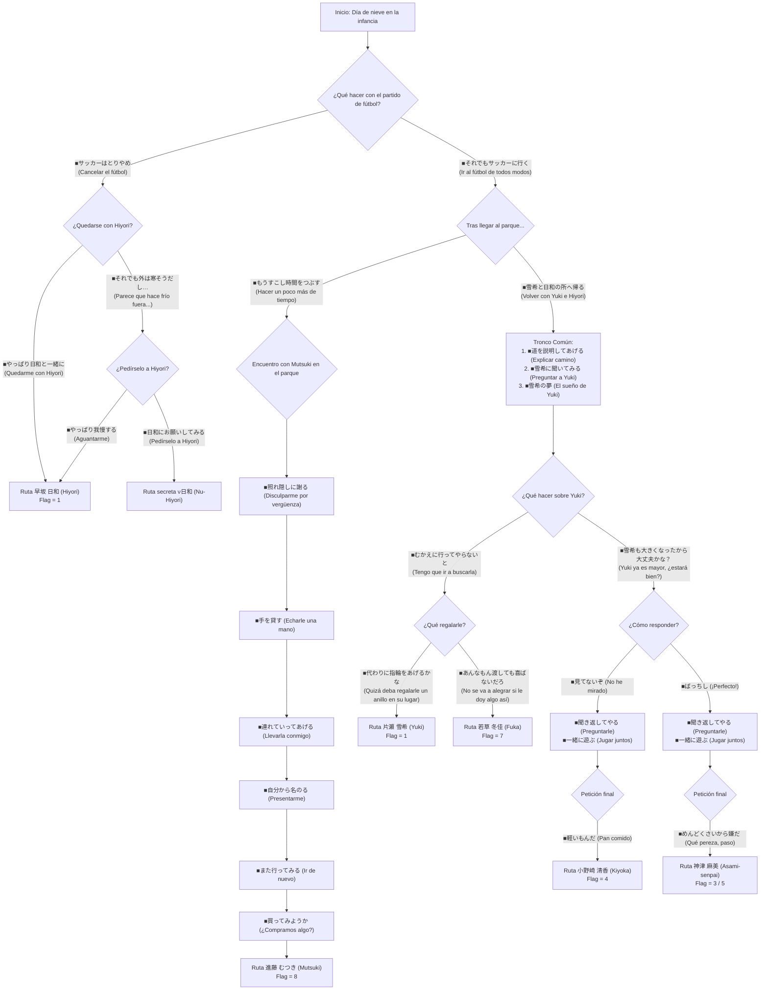

# Guía de Rutas y Decisiones — Mizuiro Remake (みずいろ)

Guía completa de progresión de rutas y selección de heroínas para *Mizuiro Remake*.

---

## 1. Estructura y Funcionamiento del Juego

*Mizuiro Remake* se divide en dos fases narrativas claramente diferenciadas:

1. **Parte Pasado / Infancia**:
   - Es el prólogo común obligatorio en una partida nueva.
   - **Aquí se decide al 100% la ruta de la heroína.**
   - Cada decisión moldea la relación de Kenji con las chicas del vecindario. Al final de la infancia, el juego evalúa las elecciones tomadas y determina la ruta correspondiente.
   - Tras reproducirse el tema de apertura (`op.wmv`), la historia salta directamente al escenario del presente correspondiente.

2. **Parte Presente / Adolescencia**:
   - Transcurre en la etapa de instituto con la heroína fijada.
   - Las elecciones dentro de estos escenarios no cambian de heroína; se enfocan en variaciones cómicas de diálogo, escenas de vida cotidiana y obtención de CGs del álbum.

---

## 2. Mapa de Rutas

| Ruta | Heroína | Rol / Descripción |
|:---:|:---|:---|
| **1** | **早坂 日和** (Hiyori Hayasaka) | Amiga de la infancia. |
| **2** | **片瀬 雪希** (Yuki Katase) | Amiga de la infancia y hermanastra. |
| **3 / 5** | **神津 麻美** (Asami Maeda) | Senpai algo peculiar. |
| **4** | **小野崎 清香** (Kiyoka Onozaki) | Compañera de clases con un lazo eno. |
| **7** | **若草 冬佳** (Fuyuka) | Profesora tutora. |
| **8** | **進藤 むつき** (Mutsuki Shindou) | Amiga de Yuki y su compañera de clases. |
| **Extra** | **ν日和** (Nu-Hiyori) | Variante cómica secreta de Hiyori. |

---

## 3. Diagrama de Flujo del Pasado

---

## 4. Guía Paso a Paso por Heroína

### 🌸 片瀬 雪希 (Yuki Katase)

**Pasos en la Infancia (`6_001.mjo`):**
1. `■それでもサッカーに行く` *(Ir al fútbol de todos modos)*
2. `■雪希と日和の所へ帰る` *(Volver a donde están Yuki e Hiyori)*
3. `■道を説明してあげる` *(Explicarle el camino)*
4. `■雪希に聞いてみる` *(Preguntarle a Yuki)*
5. `■雪希の夢` *(El sueño de Yuki)*
6. `■むかえに行ってやらないと` *(Tengo que ir a buscarla)*
7. `■代わりに指輪をあげるかな` *(Quizá deba regalarle un anillo en su lugar)* ➔ **Entra a la Ruta Yuki** (`1_001.mjo`)

**Elecciones de Afinidad en el Presente (`1_001.mjo` y `1_002.mjo`):**
Para acceder al **Epílogo (`1_003.mjo`)** y desbloquear el **After Story (`51_001.mjo`)**, la variable de afinidad `$89bf8d81` debe ser **mayor que 4 (mínimo 5 puntos)** al final de `1_002.mjo`. Las opciones que suman **+1 punto** son:

*En `1_001.mjo`:*
- Elección 1 (L5326): `■Como es Hiyori, seguir durmiendo` (`■日和なので寝る`) **(+1)**
- Elección 2 (L7637): *(Indiferente, 0 puntos)*
- Elección 3 (L8368): `■¡Ni de broma te lo doy!` (`■お前にはやるかっ！`) **(+1)**
- Elección 4 (L9917): `■¿Dejarle la comida a Yuki?` (`■食事は雪希にまかせるか？`) **(+1)**
- Elección 5 (L11447): *(Indiferente, 0 puntos)*
- Elección 6 (L13097): `■Qué pereza` (`■めんどくさい`) **(+1)**
- Elección 7 (L15158): `■Mejor un vídeo` (`■ここはビデオだな`) **(+1)**
- Elección 8 (L16554): *(Indiferente, 0 puntos)*
- Elección 9 (L19249): `■Cuidar de Shindou` (`■進藤の介抱をする`) **(+1)**
- Elección 10 (L20627): *(Indiferente, 0 puntos)*
- Elección 11 (L22679): *(Indiferente, 0 puntos)*
- Elección 12 (L27307): `■Bueno, tampoco será para tanto` (`■ま、たいした事じゃないだろ`) **(+1)**
- Elección 13 (L29039): `■¿Dejárselo a Yuki?` (`■雪希にまかせるか？`) **(+1)**
- Elección 14 (L30806): `■¿Salimos a comer a alguna parte?` (`■どっか食べにいくか？`) **(+1)**

*En `1_002.mjo`:*
- Elección 1 (L2034): *(Indiferente, 0 puntos)*
- Elección 2 (L4192): *(Indiferente, 0 puntos)*
- Elección 3 (L6238): `■Bueno... seguro que no pasa nada` (`■ま、大丈夫だろ`) **(+1)**
- Elección 4 (L6876): `■Habrá que preguntarle` (`■これは聞くしかない`) **(+1)**
- Elección 5 (L8728): *(Indiferente, 0 puntos)*
- Elección 6 (L10048): `■Preguntarle a esta puede ser peligroso` (`■こいつに聞くのは危険かも`) **(+1)**
- Elección 7 (L11581): `■No hay quien la aguante` (`■かなわんなぁ`) **(+1)**
- Elección 8 (L12924): `■¡Pedir tiempo muerto!` (`■タイムを要求！`) **(+1)**
- Elección 9 (L14263): *(Indiferente, 0 puntos)*
- Elección 10 (L17155): *(Indiferente, 0 puntos)*
- Elección 11 (L20591): `■Mejor no hacerlo` (`■やめとく`) **(+1)**
- Elección 12 (L22249): *(Indiferente, 0 puntos)*

---

### ☀️ 早坂 日和 (Hiyori Hayasaka)

**Pasos en la Infancia (`6_001.mjo`):**
1. `■Cancelar el fútbol` (`■サッカーはとりやめ`)
2. `■Quedarme con Hiyori después de todo` (`■やっぱり日和と一緒に`) ➔ **Entra a la Ruta Hiyori** (`2_001.mjo`)

**Elecciones de Afinidad en el Presente (`2_001.mjo` y `2_002.mjo`):**
- **Variable:** `savefile int $d15429c1`
- **Condición Buen Final / Epílogo (`L30679` en `2_002.mjil`):** `$d15429c1 >= 3` (**mínimo 3 puntos de 9 posibles**). Si `< 3`, termina tras `$badend@GLOBAL` sin epílogo ni desbloqueo (`$d8f380f9`).
- *En `2_001.mjo`:*
  - L9869 (`$select@MENU`): `■¿Has visto alguna vez un fantasma?` (`case 2`) **(+1)**
  - L28874: `■¡No queda otra que usar la fuerza bruta!` (`case 1`) **(+1)**
  - L32783: `■Atacar por la espalda con un "¿quién soy?"` (`case 1`) **(+1)**
  - L35130: `■Recuperar las braguitas` (`case 2`) **(+1)**
- *En `2_002.mjo`:*
  - L544: `■Empollar la noche anterior` (`case 2`) **(+1)**
  - L8392: `■Una pregunta facilísima` (`case 1`) **(+1)**
  - L9566: `■Cumplir la promesa con Hiyori` (`case 2`) **(+3)**

---

### 🧢 進藤 むつき (Mutsuki Shindou)

**Pasos en la Infancia (`6_001.mjo`):**
1. `■Ir al fútbol de todos modos` (`■それでもサッカーに行く`)
2. `■Hacer un poco más de tiempo` (`■もうすこし時間をつぶす`)
3. `■Disculparme para disimular la vergüenza` *(o con sinceridad)*
4. `■Echarle una mano` (`■手を貸す`)
5. `■Llevarla conmigo` (`■連れていってあげる`)
6. `■Presentarme primero` *(o preguntarle su nombre)*
7. `■Ir de nuevo` (`■また行ってみる`)
8. `■¿Compramos algo?` *(o me da vergüenza)* ➔ **Entra a la Ruta Mutsuki** (`3_001.mjo`)

**Elecciones de Afinidad en el Presente (`3_001.mjo` y `3_002.mjo`):**
- **Variable:** `savefile int $e894a306`
- **Condición Buen Final / Epílogo (`L32598` en `3_002.mjil`):** `$e894a306 > 1` (**mínimo 2 puntos de 5 posibles**). Si `<= 1`, salta a `$badend@GLOBAL`.
- *En `3_001.mjo`:*
  - L8102: `■Pasar por la zona comercial` (`case 1`) **(+1)**
  - L14412: `■Creo que... había algo así` (`case 2`) **(+1)**
  - L15301: `■Dirigirme a ella` (`case 1`) **(+1)**
  - L22916: `■Entretenernos por el camino juntos` (`case 1`) **(+1)**
  - L31369: `■Que nos guíe Mutsuki-chan` (`case 1`) **(+1)**
- *En `3_002.mjo`:* *(Las 7 elecciones son de variación de diálogo, 0 puntos).*

---

### 📖 小野崎 清香 (Kiyoka Onozaki)

**Pasos en la Infancia (`6_001.mjo`):**
1. `■Ir al fútbol de todos modos` (`■それでもサッカーに行く`)
2. `■Volver a donde están Yuki e Hiyori` (`■雪希と日和の所へ帰る`)
3. `■Indicarle el camino` (`■道を教えてあげる`)
4. `■Preguntarle a Yuki` (`■雪希に聞いてみる`)
5. `■El sueño de Yuki` (`■雪希の夢`)
6. `■Yuki ya es mayor, ¿estará bien?` (`■雪希も大きくなったから大丈夫かな？`)
7. `■No he mirado` *(o `■¡Perfecto!`)*
8. `■Preguntarle de vuelta` *(o dejarlo pasar)*
9. `■Jugar juntos` (`■一緒に遊ぶ`)
10. `■Pan comido` (`■軽いもんだ`) ➔ **Entra a la Ruta Kiyoka** (`4_001.mjo`)

**Elecciones de Afinidad en el Presente (`4_001.mjo` y `4_002.mjo`):**
- **Variable:** `savefile int $d89c8fea`
- **Condición Buen Final / Epílogo (`L42796` en `4_002.mjil`):** `$d89c8fea > 4` (**mínimo 5 puntos de 16 posibles**). Si `<= 4`, salta a `$badend@GLOBAL`.
- *En `4_001.mjo` (máx. 9 pts):*
  - L1552: `■Salir al pasillo` (`case 1`) **(+1)**
  - L2672: `■Meterme con Kiyoka` (`case 1`) **(+1)**
  - L6741: `■Escucharla` (`case 1`) **(+1)**
  - L7038: `■¿Qué era?` (`case 2`) **(+1)**
  - L12354: `■Cantarle las cuarenta` (`case 2`) **(+1)**
  - L12759: `■Comprobarlo un poco más` (`case 2`) **(+1)**
  - L15283: `■Toca aguantarse` (`case 2`) **(+1)**
  - L18522: `■¡En el armario, claro está!` (`case 2`) **(+1)**
  - L23502: `■Decidir no preguntar` (`case 2`) **(+1)**
- *En `4_002.mjo` (máx. 7 pts):*
  - L3419: `■Si no trabajo, te enfadarás` (`case 1`) **(+1)**
  - L5401: `■Echar un vistazo antes de marcharme` (`case 1`) **(+1)**
  - L7263: `■¿La cuido un poco?` (`case 1`) **(+1)**
  - L18921: `■Explicárselo` (`case 1`) **(+1)**
  - L19822: `■Felicitarla aunque sea un poco` (`case 1`) **(+1)**
  - L26574: `■Toca echarle valor` (`case 1`) **(+1)**
  - L29460: `■¿Y tú qué tal, Kiyoka?` (`case 2`) **(+1)**

---

### 👑 神津 麻美 (Asami Kouzu / 麻美先輩)

**Pasos en la Infancia (`6_001.mjo`):**
1. `■Ir al fútbol de todos modos` (`■それでもサッカーに行く`)
2. `■Volver a donde están Yuki e Hiyori` (`■雪希と日和の所へ帰る`)
3. `■Indicarle el camino` (`■道を教えてあげる`)
4. `■Preguntarle a Yuki` (`■雪希に聞いてみる`)
5. `■El sueño de Yuki` (`■雪希の夢`)
6. `■Yuki ya es mayor, ¿estará bien?` (`■雪希も大きくなったから大丈夫かな？`)
7. `■¡Perfecto!` *(o `■No he mirado`)*
8. `■Preguntarle de vuelta` *(o dejarlo pasar)*
9. `■Jugar juntos` (`■一緒に遊ぶ`)
10. `■Qué pereza, paso` (`■めんどくさいから嫌だ`) ➔ **Entra a la Ruta Asami** (`5_001.mjo`)

**Elecciones de Afinidad en el Presente (`5_001.mjo` y `5_002.mjo`):**
- **Variable:** `savefile int $018d5638`
- **Condición Buen Final / Epílogo (`L41064` en `5_002.mjil`):** `$018d5638 > 3` (**mínimo 4 puntos de 10 posibles**). Si `<= 3`, salta a `$badend@GLOBAL`.
- *En `5_001.mjo` (máx. 10 pts):*
  - L6096: `■Observar la situación` (`case 2`) **(+1)**
  - L7413: `■Echarle una mano` (`case 1`) **(+1)**
  - L8027: `■No, mi senpai tiene prioridad` (`case 2`) **(+1)**
  - L8205: `■Huir llevándome a mi senpai` (`case 2`) **(+1)**
  - L15896: `■Aquí me encargo yo...` (`case 1`) **(+1)**
  - L20944: `■Buscar un poco más` (`case 1`) **(+1)**
  - L28335: `■Pedirle ayuda` (`case 2`) **(+1)**
  - L35083: `■Estudiar para el examen` (`case 1`) **(+1)**
  - L36863: `■Preguntarle a dónde va` (`case 1`) **(+1)**
  - L44793: `■Comprobar la seguridad` (`case 1`) **(+1)**
- *En `5_002.mjo`:* *(Las 8 elecciones son de variación de diálogo, 0 puntos).*

---

### ☕ 若草 冬佳 (Fuyuka / 冬佳先生)

**Pasos en la Infancia (`6_001.mjo`):**
1. `■Ir al fútbol de todos modos` (`■それでもサッカーに行く`)
2. `■Volver a donde están Yuki e Hiyori` (`■雪希と日和の所へ帰る`)
3. `■Indicarle el camino` (`■道を教えてあげる`)
4. `■Preguntarle a Yuki` (`■雪希に聞いてみる`)
5. `■El sueño de Yuki` (`■雪希の夢`)
6. `■Tengo que ir a buscarla` (`■むかえに行ってやらないと`)
7. `■No se va a alegrar si le doy algo así` (`■あんなもん渡しても喜ばないだろ`) ➔ **Entra a la Ruta Fuyuka** (`7_001.mjo`)

**Elecciones de Afinidad en el Presente (`7_001.mjo` y `7_002.mjo`):**
Para alcanzar el **Buen Final / Epílogo** (en `@block_4080a` de `7_002.mjo`) y evitar el `$badend@GLOBAL`, la variable de afinidad `$38ee6175` debe ser **mayor que 11 (mínimo 12 puntos de 27 posibles)** al llegar a la línea 25208 de `7_002.mjil`.

*En `7_001.mjo` (máximo 7 puntos):*
- Elección 1 (L728): `■¿Pesa mucho o algo así?` (`■重いものでもあるのか？`) **(+1)**
- Elección 2 (L1319): *(Indiferente, 0 puntos)*
- Elección 3 (L1909): *(Indiferente, 0 puntos)*
- Elección 4 (L4823): `■Entendido, entendido` (`■わかったわかった`) **(+1)**
- Elección 5 (L5956): `■¿Qué pasa?` (`■何だよ？`) **(+1)**
- Elección 6 (L6928): *(Indiferente, 0 puntos)*
- Elección 7 (L10027): `■Así está perfecto.` (`■それくらいがベストだ。`) **(+1)**
- Elección 8 (L10765): *(Indiferente, 0 puntos)*
- Elección 9 (L12318): *(Indiferente, 0 puntos)*
- Elección 10 (L15096): *(Indiferente, 0 puntos)*
- Elección 11 (L16182): `■¡Si empujando no cede, toca tirar!` (`■押しても駄目なら引いてみろ、だ！`) **(+1)**
- Elección 12 (L16821): `■No, no lo creo.` (`■いや、思ってない。`) **(+1)**
- Elección 13 (L19985): `■Perdona, es que en realidad es una chica.` (`■スマン、あいつは女なんだ。`) **(+1)**
- Elección 14 (L23440): *(Indiferente, 0 puntos)*
- Elección 15 (L24080): *(Indiferente, 0 puntos)*
- Elección 16 (L24835): *(Indiferente, 0 puntos)*

*En `7_002.mjo` (máximo 20 puntos):*
- Elección 1 (L6627): `■Comamos juntos` (`■一緒に食おうぜ`) **(+5)**
- Elección 2 (L7145): `■¿Qué estudiaste en la universidad?` (`■大学でなに専攻してんだ？`) **(+1)**
- Elección 3 (L9009): `■Quería acompañarla, sensei.` (`■先生を送りたかったんだ。`) **(+5)**
- Elección 4 (L14145): `■Rechazar` (`■断る`) **(+1)**
- Elección 5 (L15298): `■No rechazar` (`■断らない`) **(+5)**
- Elección 6 (L19429): `■Dejárselo a ella` (`■任せる`) **(+3)**

---

### 🌀 ν日和 (Nu-Hiyori)

**Pasos en la Infancia (`6_001.mjo`):**
1. `■Cancelar el fútbol` (`■サッカーはとりやめ`)
2. `■Aun así parece que hace frío fuera...` (`■それでも外は寒そうだし…`)
3. `■Pedírselo a Hiyori` (`■日和にお願いしてみる`) ➔ **Entra a la Ruta Nu-Hiyori** (`8_001.mjo`)

**Elecciones de Afinidad en el Presente (`8_001.mjo` y `8_002.mjo`):**
- **Variable:** `savefile int $545da70a`
- **Condición Buen Final / Epílogo (`L18174` en `8_002.mjil`):** `$545da70a > 3` (**mínimo 4 puntos de 13 posibles**). Si `<= 3`, salta a `$badend@GLOBAL`.
- *En `8_001.mjo` (máx. 10 pts):*
  - L375: `■Levantarme dócilmente` (`case 1`) **(+1)**
  - L3346: `■No has cambiado nada` (`case 1`) **(+1)**
  - L5004: `■Usar el mío propio` (`case 2`) **(+1)**
  - L8685: `■Recomendarle que lo compre` (`case 2`) **(+1)**
  - L10203: `■¿Salimos a divertirnos a alguna parte?` (`case 1`) **(+1)**
  - L10755: `■De acuerdo` (`case 1`) **(+3)**
  - L15137: `■Para mí, un directo` (`case 2`) **(+1)**
  - L16494: `■Le voy a dar una paliza` (`case 2`) **(+1)**
- *En `8_002.mjo` (máx. 3 pts):*
  - L3261: `■La montaña rusa` (`case 1`) **(+1)**
  - L7417: `■Usar el de Hiyori a propósito` (`case 2`) **(+1)**
  - L10366: `■Ya está decidido` (`case 2`) **(+1)**

---

## 5. Contenidos Extra y Desbloqueables

- **After Story de Yuki**: Se desbloquea tras alcanzar el final de 片瀬雪希. Permite ver el epílogo y las CGs finales.
- **Escenario "Mizuiro" en Menú Principal**: Se desbloquea tras finalizar la ruta de 早坂日和.
- **Staff Room (Sala del Personal)**: Accesible desde los extras tras completar el juego. El programador original Chouhata incluye comentarios y la guía de rutas oficial.
- **Historias Omake**:
  - *愛衣と雛姫* (Ai y Hinaki)
  - *愛衣と雛姫、その後* (Ai y Hinaki, después)
  - *野望* (Ambición)
