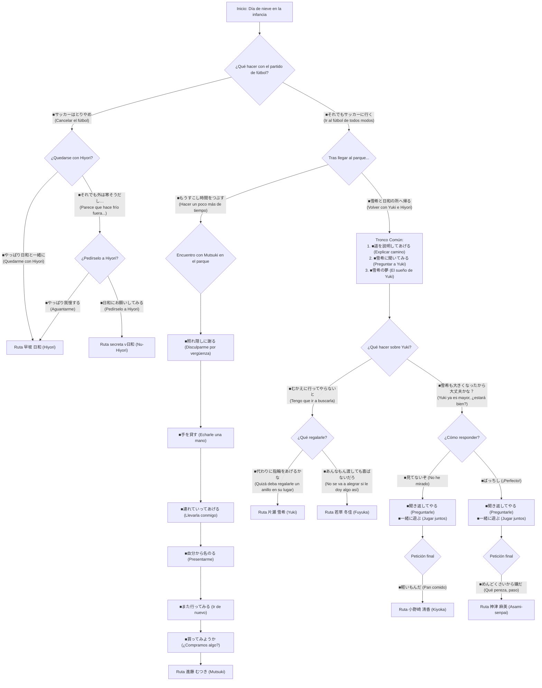

# Guía de Rutas y Decisiones — Mizuiro Remake (みずいろ)

Guía completa de progresión de rutas y selección de heroínas para *Mizuiro Remake*.

---

## 1. Estructura y Funcionamiento del Juego

*Mizuiro Remake* se divide en dos fases narrativas claramente diferenciadas:

1. **Parte Pasado / Infancia**:
   - Es el prólogo común obligatorio en una partida nueva.
   - **Aquí se decide al 100% la ruta de la heroína.**
   - Cada decisión moldea la relación de Kenji con las chicas del vecindario. Al final de la infancia, el juego evalúa las elecciones tomadas y determina la ruta correspondiente.
   - Tras reproducirse el tema de apertura (`op.wmv`), la historia salta directamente al escenario del presente correspondiente.

2. **Parte Presente / Adolescencia**:
   - Transcurre en la etapa de instituto con la heroína fijada.
   - Las elecciones dentro de estos escenarios no cambian de heroína; se enfocan en variaciones cómicas de diálogo, escenas de vida cotidiana y obtención de CGs del álbum.

---

## 2. Mapa de Rutas

| Ruta | Heroína | Rol / Descripción |
|:---:|:---|:---|
| **1** | **早坂 日和** (Hiyori Hayasaka) | Amiga de la infancia. |
| **2** | **片瀬 雪希** (Yuki Katase) | Amiga de la infancia y hermanastra. |
| **3 / 5** | **神津 麻美** (Asami Maeda) | Senpai algo peculiar. |
| **4** | **小野崎 清香** (Kiyoka Onozaki) | Compañera de clases con un lazo enorme. |
| **7** | **若草 冬佳** (Fuyuka Ishikawa) | Profesora tutora. |
| **8** | **進藤 むつき** (Mutsuki Shindou) | Amiga de Yuki y su compañera de clases. |
| **Extra** | **ν日和** (Nu-Hiyori) | Variante cómica secreta de Hiyori. |

---

## 3. Diagrama de Flujo del Pasado

---

## 4. Guía Paso a Paso por Heroína

### 🌸 片瀬 雪希 (Yuki Katase)

**Pasos en la Infancia:**
1. `■それでもサッカーに行く` *(Ir al fútbol de todos modos)*
2. `■雪希と日和の所へ帰る` *(Volver a donde están Yuki e Hiyori)*
3. `■道を説明してあげる` *(Explicarle el camino)*
4. `■雪希に聞いてみる` *(Preguntarle a Yuki)*
5. `■雪希の夢` *(El sueño de Yuki)*
6. `■むかえに行ってやらないと` *(Tengo que ir a buscarla)*
7. `■代わりに指輪をあげるかな` *(Quizá deba regalarle un anillo en su lugar)* ➔ **Entra a la Ruta Yuki**

**Elecciones de Afinidad en el Presente:**
Para acceder al **Epílogo** y desbloquear el **After Story**, se requiere acumular **mínimo 5 puntos** al final del presente. Las opciones que suman **+1 punto** son:

*Parte 1:*
- Elección 1: `■Como es Hiyori, seguir durmiendo` (`■日和なので寝る`) **(+1)**
- Elección 2: *(Indiferente, 0 puntos)*
- Elección 3: `■¡Ni de broma te lo doy!` (`■お前にはやるかっ！`) **(+1)**
- Elección 4: `■¿Dejarle la comida a Yuki?` (`■食事は雪希にまかせるか？`) **(+1)**
- Elección 5: *(Indiferente, 0 puntos)*
- Elección 6: `■Qué pereza` (`■めんどくさい`) **(+1)**
- Elección 7: `■Mejor un vídeo` (`■ここはビデオだな`) **(+1)**
- Elección 8: *(Indiferente, 0 puntos)*
- Elección 9: `■Cuidar de Shindou` (`■進藤の介抱をする`) **(+1)**
- Elección 10: *(Indiferente, 0 puntos)*
- Elección 11: *(Indiferente, 0 puntos)*
- Elección 12: `■Bueno, tampoco será para tanto` (`■ま、たいした事じゃないだろ`) **(+1)**
- Elección 13: `■¿Dejárselo a Yuki?` (`■雪希にまかせるか？`) **(+1)**
- Elección 14: `■¿Salimos a comer a alguna parte?` (`■どっか食べにいくか？`) **(+1)**

*Parte 2:*
- Elección 1: *(Indiferente, 0 puntos)*
- Elección 2: *(Indiferente, 0 puntos)*
- Elección 3: `■Bueno... seguro que no pasa nada` (`■ま、大丈夫だろ`) **(+1)**
- Elección 4: `■Habrá que preguntarle` (`■これは聞くしかない`) **(+1)**
- Elección 5: *(Indiferente, 0 puntos)*
- Elección 6: `■Preguntarle a esta puede ser peligroso` (`■こいつに聞くのは危険かも`) **(+1)**
- Elección 7: `■No hay quien la aguante` (`■かなわんなぁ`) **(+1)**
- Elección 8: `■¡Pedir tiempo muerto!` (`■タイムを要求！`) **(+1)**
- Elección 9: *(Indiferente, 0 puntos)*
- Elección 10: *(Indiferente, 0 puntos)*
- Elección 11: `■Mejor no hacerlo` (`■やめとく`) **(+1)**
- Elección 12: *(Indiferente, 0 puntos)*

---

### ☀️ 早坂 日和 (Hiyori Hayasaka)

**Pasos en la Infancia:**
1. `■Cancelar el fútbol` (`■サッカーはとりやめ`)
2. `■Quedarme con Hiyori después de todo` (`■やっぱり日和と一緒に`) ➔ **Entra a la Ruta Hiyori**

**Elecciones de Afinidad en el Presente:**
- **Condición Buen Final / Epílogo:** **Mínimo 3 puntos de 9 posibles**.
- *Parte 1:*
  - Elección 1: `■¿Has visto alguna vez un fantasma?` **(+1)**
  - Elección 2: `■¡No queda otra que usar la fuerza bruta!` **(+1)**
  - Elección 3: `■Atacar por la espalda con un "¿quién soy?"` **(+1)**
  - Elección 4: `■Recuperar las braguitas` **(+1)**
- *Parte 2:*
  - Elección 1: `■Empollar la noche anterior` **(+1)**
  - Elección 2: `■Una pregunta facilísima` **(+1)**
  - Elección 3: `■Cumplir la promesa con Hiyori` **(+3)**

---

### 🧢 進藤 むつき (Mutsuki Shindou)

**Pasos en la Infancia:**
1. `■Ir al fútbol de todos modos` (`■それでもサッカーに行く`)
2. `■Hacer un poco más de tiempo` (`■もうすこし時間をつぶす`)
3. `■Disculparme para disimular la vergüenza` *(o con sinceridad)*
4. `■Echarle una mano` (`■手を貸す`)
5. `■Llevarla conmigo` (`■連れていってあげる`)
6. `■Presentarme primero` *(o preguntarle su nombre)*
7. `■Ir de nuevo` (`■また行ってみる`)
8. `■¿Compramos algo?` *(o me da vergüenza)* ➔ **Entra a la Ruta Mutsuki**

**Elecciones de Afinidad en el Presente:**
- **Condición Buen Final / Epílogo:** **Mínimo 2 puntos de 5 posibles**.
- *Parte 1:*
  - Elección 1: `■Pasar por la zona comercial` **(+1)**
  - Elección 2: `■Creo que... había algo así` **(+1)**
  - Elección 3: `■Dirigirme a ella` **(+1)**
  - Elección 4: `■Entretenernos por el camino juntos` **(+1)**
  - Elección 5: `■Que nos guíe Mutsuki-chan` **(+1)**
- *Parte 2:* *(Las elecciones son de variación de diálogo, 0 puntos).*

---

### 📖 小野崎 清香 (Kiyoka Onozaki)

**Pasos en la Infancia:**
1. `■Ir al fútbol de todos modos` (`■それでもサッカーに行く`)
2. `■Volver a donde están Yuki e Hiyori` (`■雪希と日和の所へ帰る`)
3. `■Indicarle el camino` (`■道を教えてあげる`)
4. `■Preguntarle a Yuki` (`■雪希に聞いてみる`)
5. `■El sueño de Yuki` (`■雪希の夢`)
6. `■Yuki ya es mayor, ¿estará bien?` (`■雪希も大きくなったから大丈夫かな？`)
7. `■No he mirado` *(o `■¡Perfecto!`)*
8. `■Preguntarle de vuelta` *(o dejarlo pasar)*
9. `■Jugar juntos` (`■一緒に遊ぶ`)
10. `■Pan comido` (`■軽いもんだ`) ➔ **Entra a la Ruta Kiyoka**

**Elecciones de Afinidad en el Presente:**
- **Condición Buen Final / Epílogo:** **Mínimo 5 puntos de 16 posibles**.
- *Parte 1 (máx. 9 pts):*
  - Elección 1: `■Salir al pasillo` **(+1)**
  - Elección 2: `■Meterme con Kiyoka` **(+1)**
  - Elección 3: `■Escucharla` **(+1)**
  - Elección 4: `■¿Qué era?` **(+1)**
  - Elección 5: `■Cantarle las cuarenta` **(+1)**
  - Elección 6: `■Comprobarlo un poco más` **(+1)**
  - Elección 7: `■Toca aguantarse` **(+1)**
  - Elección 8: `■¡En el armario, claro está!` **(+1)**
  - Elección 9: `■Decidir no preguntar` **(+1)**
- *Parte 2 (máx. 7 pts):*
  - Elección 1: `■Si no trabajo, te enfadarás` **(+1)**
  - Elección 2: `■Echar un vistazo antes de marcharme` **(+1)**
  - Elección 3: `■¿La cuido un poco?` **(+1)**
  - Elección 4: `■Explicárselo` **(+1)**
  - Elección 5: `■Felicitarla aunque sea un poco` **(+1)**
  - Elección 6: `■Toca echarle valor` **(+1)**
  - Elección 7: `■¿Y tú qué tal, Kiyoka?` **(+1)**

---

### 👑 神津 麻美 (Asami Kouzu / 麻美先輩)

**Pasos en la Infancia:**
1. `■Ir al fútbol de todos modos` (`■それでもサッカーに行く`)
2. `■Volver a donde están Yuki e Hiyori` (`■雪希と日和の所へ帰る`)
3. `■Indicarle el camino` (`■道を教えてあげる`)
4. `■Preguntarle a Yuki` (`■雪希に聞いてみる`)
5. `■El sueño de Yuki` (`■雪希の夢`)
6. `■Yuki ya es mayor, ¿estará bien?` (`■雪希も大きくなったから大丈夫かな？`)
7. `■¡Perfecto!` *(o `■No he mirado`)*
8. `■Preguntarle de vuelta` *(o dejarlo pasar)*
9. `■Jugar juntos` (`■一緒に遊ぶ`)
10. `■Qué pereza, paso` (`■めんどくさいから嫌だ`) ➔ **Entra a la Ruta Asami**

**Elecciones de Afinidad en el Presente:**
- **Condición Buen Final / Epílogo:** **Mínimo 4 puntos de 10 posibles**.
- *Parte 1 (máx. 10 pts):*
  - Elección 1: `■Observar la situación` **(+1)**
  - Elección 2: `■Echarle una mano` **(+1)**
  - Elección 3: `■No, mi senpai tiene prioridad` **(+1)**
  - Elección 4: `■Huir llevándome a mi senpai` **(+1)**
  - Elección 5: `■Aquí me encargo yo...` **(+1)**
  - Elección 6: `■Buscar un poco más` **(+1)**
  - Elección 7: `■Pedirle ayuda` **(+1)**
  - Elección 8: `■Estudiar para el examen` **(+1)**
  - Elección 9: `■Preguntarle a dónde va` **(+1)**
  - Elección 10: `■Comprobar la seguridad` **(+1)**
- *Parte 2:* *(Las elecciones son de variación de diálogo, 0 puntos).*

---

### ☕ 若草 冬佳 (Fuyuka Ishikawa / 冬佳先生)

**Pasos en la Infancia:**
1. `■Ir al fútbol de todos modos` (`■それでもサッカーに行く`)
2. `■Volver a donde están Yuki e Hiyori` (`■雪希と日和の所へ帰る`)
3. `■Indicarle el camino` (`■道を教えてあげる`)
4. `■Preguntarle a Yuki` (`■雪希に聞いてみる`)
5. `■El sueño de Yuki` (`■雪希の夢`)
6. `■Tengo que ir a buscarla` (`■むかえに行ってやらないと`)
7. `■No se va a alegrar si le doy algo así` (`■あんなもん渡しても喜ばないだろ`) ➔ **Entra a la Ruta Fuyuka**

**Elecciones de Afinidad en el Presente:**
Para alcanzar el **Buen Final / Epílogo**, se requiere acumular **mínimo 12 puntos de 27 posibles**.

*Parte 1 (máximo 7 puntos):*
- Elección 1: `■¿Pesa mucho o algo así?` (`■重いものでもあるのか？`) **(+1)**
- Elección 2: *(Indiferente, 0 puntos)*
- Elección 3: *(Indiferente, 0 puntos)*
- Elección 4: `■Entendido, entendido` (`■わかったわかった`) **(+1)**
- Elección 5: `■¿Qué pasa?` (`■何だよ？`) **(+1)**
- Elección 6: *(Indiferente, 0 puntos)*
- Elección 7: `■Así está perfecto.` (`■それくらいがベストだ。`) **(+1)**
- Elección 8: *(Indiferente, 0 puntos)*
- Elección 9: *(Indiferente, 0 puntos)*
- Elección 10: *(Indiferente, 0 puntos)*
- Elección 11: `■¡Si empujando no cede, toca tirar!` (`■押しても駄目なら引いてみろ、だ！`) **(+1)**
- Elección 12: `■No, no lo creo.` (`■いや、思ってない。`) **(+1)**
- Elección 13: `■Perdona, es que en realidad es una chica.` (`■スマン、あいつは女なんだ。`) **(+1)**
- Elección 14: *(Indiferente, 0 puntos)*
- Elección 15: *(Indiferente, 0 puntos)*
- Elección 16: *(Indiferente, 0 puntos)*

*Parte 2 (máximo 20 puntos):*
- Elección 1: `■Comamos juntos` (`■一緒に食おうぜ`) **(+5)**
- Elección 2: `■¿Qué estudiaste en la universidad?` (`■大学でなに専攻してんだ？`) **(+1)**
- Elección 3: `■Quería acompañarla, sensei.` (`■先生を送りたかったんだ。`) **(+5)**
- Elección 4: `■Rechazar` (`■断る`) **(+1)**
- Elección 5: `■No rechazar` (`■断らない`) **(+5)**
- Elección 6: `■Dejárselo a ella` (`■任せる`) **(+3)**

---

### 🌀 ν日和 (Nu-Hiyori)

**Pasos en la Infancia:**
1. `■Cancelar el fútbol` (`■サッカーはとりやめ`)
2. `■Aun así parece que hace frío fuera...` (`■それでも外は寒そうだし…`)
3. `■Pedírselo a Hiyori` (`■日和にお願いしてみる`) ➔ **Entra a la Ruta Nu-Hiyori**

**Elecciones de Afinidad en el Presente:**
- **Condición Buen Final / Epílogo:** **Mínimo 4 puntos de 13 posibles**.
- *Parte 1 (máx. 10 pts):*
  - Elección 1: `■Levantarme dócilmente` **(+1)**
  - Elección 2: `■No has cambiado nada` **(+1)**
  - Elección 3: `■Usar el mío propio` **(+1)**
  - Elección 4: `■Recomendarle que lo compre` **(+1)**
  - Elección 5: `■¿Salimos a divertirnos a alguna parte?` **(+1)**
  - Elección 6: `■De acuerdo` **(+3)**
  - Elección 7: `■Para mí, un directo` **(+1)**
  - Elección 8: `■Le voy a dar una paliza` **(+1)**
- *Parte 2 (máx. 3 pts):*
  - Elección 1: `■La montaña rusa` **(+1)**
  - Elección 2: `■Usar el de Hiyori a propósito` **(+1)**
  - Elección 3: `■Ya está decidido` **(+1)**

---

## 5. Contenidos Extra y Desbloqueables

- **After Story de Yuki**: Se desbloquea tras alcanzar el final de 片瀬雪希. Permite ver el epílogo y las CGs finales.
- **Escenario "Mizuiro" en Menú Principal**: Se desbloquea tras finalizar la ruta de 早坂日和.
- **Staff Room (Sala del Personal)**: Accesible desde los extras tras completar el juego. El programador original Chouhata incluye comentarios y la guía de rutas oficial.
- **Historias Omake**:
  - *愛衣と雛姫* (Ai y Hinaki)
  - *愛衣と雛姫、その後* (Ai y Hinaki, después)
  - *野望* (Ambición)
